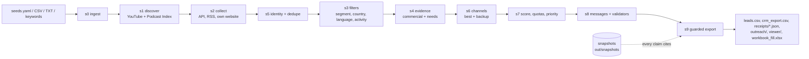

# Receipts Engine

Finds creators who need IncuBrix, proves each one against 7 checks with clickable evidence (a "receipt" for every claim), picks the best and backup outreach channel, drafts personalised 3-step sequences for email, LinkedIn and contact forms, and exports a CRM-ready lead list. Refreshing adds new leads, re-verifies stale ones and never creates duplicates.



Every fetched response is saved as a snapshot. Every receipt points to a URL, a snapshot and a verbatim quote or recomputable metric. An LLM claim counts only if its quote is found verbatim in a snapshot.

## Quick start

Requirements: Python 3.11 (or `uv`), `make`.

```bash
make setup     # venv, dependencies (exact pins in pyproject.toml / requirements.lock), DB
make demo      # no keys, no network: replays fixtures into out/demo/, prints a trace, runs an audit
make run       # live run with keys: receipts run --input config/seeds.yaml --target 1200
make test      # pytest
```

Open `out/demo/viewer/index.html` after the demo. Until real fixtures are recorded, the demo replays a clearly synthetic test world (`Synthetic Creator NNNN`, `.test` domains). Its output files are named `*_DEMO_not_live.csv` and can never become `out/leads.csv` (guard G1).

## Keys (`.env`, copied from `.env.example`)

| Key | Needed for | Optional? |
|---|---|---|
| `YOUTUBE_API_KEY` | YouTube discovery and collection | required for live runs |
| `PODCASTINDEX_KEY`, `PODCASTINDEX_SECRET` | podcast discovery | required for podcasts |
| `ANTHROPIC_API_KEY` | ambiguous-case judgements and hook polishing (`claude-haiku-5-5`) | optional: without it the engine runs rules-only |
| `SMTP_*`, `IMAP_*` | seed test email channel and reply logging | seed test only |
| `COMMUNITY_WEBHOOK_URL` | seed-test fallback channel (private Discord/Slack) | optional |

Before a real export also fill `sender.*` and `offer_line` in `config/settings.yaml`, `seed_test.allowed_recipients`, and, for the workbook, `config/submission.yaml`, `insight.yaml` and `selfscore.yaml`. Export refuses to run while any of these still contain `TODO` (G4) and lists what is missing.

Record real replay fixtures once: fill `tests/fixtures/record_targets.yaml`, then run `python scripts/record_fixtures.py`.

## Input formats

```bash
receipts run --input config/seeds.yaml                 # discovery matrix: niches x intents x templates + podcast terms
receipts run --input leads.csv                         # columns: url, handle, channel_id, feed_url, rss, website, name, channel
receipts run --input list.txt                          # one per line
receipts run --input x --keywords "sales coach,marketing podcast"
```

Each cell can be a channel id (`UC…`), a channel URL, `@handle`, a feed URL (`.xml`, `/feed`, `rss`), `pi:<podcast index id>` or a website. Unparseable rows go to `rejects.csv` as `unparseable_input`, with the original text.

## Outputs

| File | What |
|---|---|
| `out/leads.csv` | 30 columns (BUILD_SPEC 9.1), qualified, live-evidence leads only, sorted by `lead_id` |
| `out/rejects.csv` | every rejected candidate with stage, reason code and detail |
| `out/crm_export.csv` | CRM import: contact and backup, 3 messages, next step due, source basis |
| `out/receipts/<lead_id>.json` | every receipt with snapshot path, check time and verifier |
| `out/outreach/` | sequences per segment and channel, Priority A packs, first messages, validator report |
| `out/viewer/` | static HTML: searchable lead table, one page per lead with the 7 checks, summary |
| `out/workbook_fill.xlsx` | the submission workbook with only its yellow input cells filled (`--workbook`) |
| `out/logs/` | JSONL run logs, `balance.json`, audit JSON, possible-duplicate review file |

The 7 checks: real and relevant, active, commercial, needs IncuBrix, reachable, personalised, complete and unique. Country and language receipts are kept too.

## Refresh, resume, dedupe

- `receipts refresh --input …` processes new input, re-verifies creators older than `freshness.ttl_refresh_days` (14), and prints a diff: new, re-verified, newly rejected. Running the same input again adds 0 rows.
- State is committed to SQLite after every candidate. On quota exhaustion or a rejected key, the run stops cleanly (`status=partial`), defers the remaining candidates and prints the exact `--resume` command.
- Each creator has one `creator_key`, from the strongest anchor: YouTube channel id, then Podcast Index id, then website domain. Any shared identity (channel, feed, domain, handle, a verified social profile) merges into the earlier key. Similar names only go to `out/logs/review_possible_dupes.csv`; they are never merged.

## Operator console

```bash
receipts ui            # http://127.0.0.1:8080 (make ui); after `make demo`, `make demo-ui` opens the demo DB
```

A local web app that reads `state.db` live:

- **Dashboard:** the acceptance rules (A1, A2, A5, A6) and a "ready for a real run?" checklist (config TODOs, which keys are present, never their values, recorded fixtures, workbook), plus country and segment balance against the caps, the best-channel mix and recent runs.
- **Leads:** search, filters (status, segment, country, priority, best channel), sorting and paging.
- **Lead page:** the 7 checks, each with its receipts, evidence links and "view snapshot" (the exact text the quote was verified against, with the quote highlighted); the score breakdown; every channel with its proof; messages with validator reports and copy buttons; identities and recent items.
- **Manual checks:** record a LinkedIn, Instagram or X check from the lead page with a date and screenshot upload. This is the same as `receipts manual-check` and re-selects best and backup.
- **Rejects** by reason code, **Runs & audits** (run ledger, audit history and root causes, quota balance), and the **Seed test** schedule, clicks and replies, with forms to log assisted sends and replies.

The console binds to localhost and has no login; do not expose it publicly. Text from fetched pages is shown escaped and is never rendered as HTML. The static `out/viewer/` export remains the shareable read-only version.

## Tracing and auditing

```bash
receipts trace L0001            # all receipts: URL, fetch time, quote/metric, snapshot path, score, messages
receipts audit --n 20 --seed 7 --channels 20 [--live]
receipts stats [--dupes] [--balance] [--priority]   # non-zero exit if an acceptance rule fails
```

The audit samples leads with a fixed seed. It re-verifies every quote against its snapshot (with `--live`, against a fresh fetch, and requires HTTP 200), recomputes metrics, and checks channel provenance, MX and name match. Results go to `docs/self_audit.md`, with history.

## Seed test

Only your own accounts, never creators (G2). Five synthetic test leads, 3 steps, with time compressed so 1 day = 1 minute.

```bash
receipts tracker --port 8000 &          # click redirect + test contact form
receipts seed-test --all                # schedules, sends step 1 (email, form), queues LinkedIn for you
receipts seed-test --tick               # later: sends due steps, polls IMAP replies, honours STOP
receipts log-sent T001 --channel linkedin --step 1
receipts log-reply T001 --channel linkedin --label positive
```

Report: `out/seedtest/seedtest_report.md`. Add screenshots to `docs/seedtest_screenshots/`.

## Tests

`make test` runs about 200 tests. They cover the guards G1–G8, activity boundaries, country and language rules, quote verification, every check, dedupe, channels, scoring and quotas, all validators, refresh, recovery, export, the workbook, the audit, the seed test and a CLI smoke test. Tests use synthetic fixtures only.

## Runtime and cost

| Run | Rows | Time | Notes |
|---|---|---|---|
| Bench (synthetic replay, not live) | 5,000 | ~82 s on an M-series Mac | 250 injected duplicates, 0 remaining; ~0.9 GB peak (language model) |

Live runs are bounded by the YouTube quota. `search.list` costs 100 units, so about 90 searches fit in a 10,000-unit day at the 90% stop. Collection costs about 3 units per channel. The engine also waits `per_host_delay_s` between requests to the same website. `docs/run_report.md` holds the measured runtime, units and LLM cost of every run (`receipts report`).

## Compliance and limitations

See `docs/compliance.md`: public business information only, official APIs, robots.txt honoured, no logins, no guessed contacts, sender identity and opt-out in every message, `receipts forget`. Known limits are listed in `docs/assumptions.md`, including the unverified API semantics and the untested workbook mapping. Design choices are in `docs/decisions.md`.

## Troubleshooting

| Symptom | Fix |
|---|---|
| `STOPPED: … quota exceeded` | wait for the UTC reset (or raise the quota), then rerun with `--resume` |
| `YouTube rejected the API key` | fix `YOUTUBE_API_KEY` in `.env`, then `--resume` |
| many `robots` skips in the log | the site disallows our user agent; the engine respects it, so there is nothing to do |
| `export blocked: … TODO` | fill the listed settings |
| `export blocked: quota balance violated` | see `out/logs/balance.json`; discover more in the short countries or segments |
| `fixture_missing` rejects | in replay mode a response was never recorded; re-run `scripts/record_fixtures.py` |
